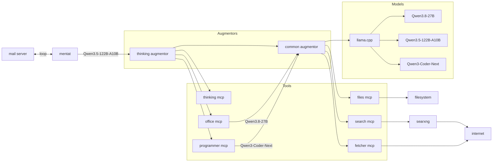
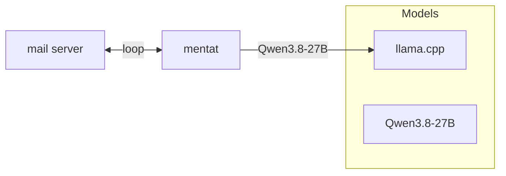
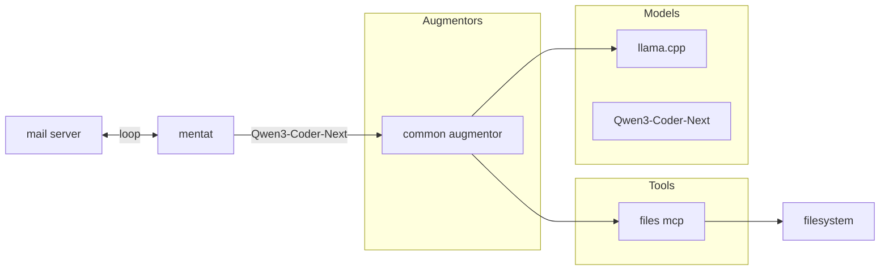

# Mentat-AI-Agent

## Unix Way

> Do one thing and do it well.

The principle states: create small, simple programs that solve a specific task, and build complex systems by combining these programs through standard interfaces.

In particular, I would highlight the following rules that inspired me during the design process:
- Modularity Rule: write simple parts joined by clear interfaces.
- Composition Rule: design programs so that they can be combined with other programs.

A separate rule for critics:
- Diversity Rule: reject all claims of “the one right way”.

And one more rule, formulated back at the beginning of the century, but which has become truly relevant only today:
- Generation Rule: avoid hand-coding; whenever convenient, write programs that write programs;

## Problem

As you might guess, I’m a big supporter of open, extensible, modular software. I’m a fan of Linux and microservice architecture, and not a big fan of large, complex frameworks that offer to solve every possible problem out of the box (even though I write in .NET). For this reason, I’m largely upset by the growing trend of dependence on large corporations in programming, when you have to pay subscription fees just to create software or access knowledge. Perhaps, as technology develops further, hardware and the models themselves will become much more accessible to run on local devices, and more tools for this will start appearing, but I don’t want to sit around waiting for those times to come. That’s why the idea emerged to build my own modular agent from available open-source components in the way I want to see it.

## Definitions

*AI Agent* — an autonomous program that uses a large language model (LLM) to achieve a specified goal — the agent does not simply answer a question, but plans a sequence of steps, selects tools, performs actions, and analyzes the results in order to solve a task.

*Tools* — external functions or software interfaces that the agent can call to interact with the world outside the language model — its “hands,” “eyes,” and “ears.”

*OpenAI API* — a REST API contract for accessing LLMs created by OpenAI company, which has become a de facto standard for many model-running engines (it is not a common standard, but we have what we have).

*Llama.cpp* — an open-source engine for running large language models (LLMs) locally, supporting quantization, hardware acceleration on various GPUs, hybrid CPU + GPU execution, and providing an OpenAI API for interacting with models.

## Preparing

For running the agent, I have a home server assembled from used components:
- Motherboard: Supermicro H11SSL-i
- CPU: AMD EPYC 7601 (32 cores, 64 threads, 8 memory channels)
- RAM: 64x8 GB DDR4 2400MHz
- SSD: 2 TB
- OS: Ubuntu Server 26.04.1 LTS

I also used the following LLMs, which can be downloaded from the website:
- [Qwen3.8-27B-GGUF](https://huggingface.co/unsloth/Qwen3.8-27B-GGUF) BF16 quant
- [Qwen3.5-122B-A10B-GGUF](https://huggingface.co/unsloth/Qwen3.5-122B-A10B-GGUF) UD-Q8_K_XL quant
- [Qwen3-Coder-Next-GGUF](https://huggingface.co/unsloth/Qwen3-Coder-Next-GGUF) UD-Q8_K_XL quant

Download the GGUF files for these models into separate folders for each model and place them in a common *models* folder.

## Architecture

The component interaction scheme is as follows:



The architecture is built on a modular principle. Tools can be independently connected to or disconnected from the augmentors (more details about them below). The composition of the augmentors themselves can also be changed depending on the task and the principles of composing toolsets. Interaction between components occurs through the OpenAI contract, while tools are connected via the standard MCP web protocol. Thus, llama.cpp can be replaced with any server that supports requests through the OpenAI contract. The client, which in this implementation listens for incoming email, can also be replaced with any other agent that supports sending requests to the OpenAI API, even if it has its own set of tools and its own algorithm for invoking them, because in this scheme the client is completely unaware of the presence of any tools — their invocation and processing are completely hidden from it. Each component is strictly responsible for performing only its own function and does not require the presence of any other related components to operate.

For clarity, I want to show additional configurations that are possible depending on requirements:



or



## Implementation

The complete script for launching the agent system looks like this:

<!-- snippet: FullCompose -->
<a id='snippet-FullCompose'></a>
```yaml
services:

  llama:
    image: ghcr.io/ggml-org/llama.cpp:server
    restart: unless-stopped
    ports:
      - "11434:8080"
    volumes:
      - ./models:/models
    command:
      - "--models-dir"
      - "/models"
      - "--port"
      - "8080"
      - "--host"
      - "0.0.0.0"

  mentat:
    image: gendalf90/mentat:latest
    restart: unless-stopped
    depends_on:
      - thinking-tools-augmentor
    environment:
      OpenAIUrl: "http://thinking-tools-augmentor:8080"
      OpenAIModel: "Qwen3.5-122B-A10B-GGUF"
      MailImapHost: "imap.mail.ru"
      MailSmtpHost: "smtp.mail.ru"
      MailUsers: "user-to-be-answered@mail.com"
      MailLogin: "user-to-login@mail.ru"
      MailPassword: "<mail server app password>"

  programmer-buddy-mcp:
    image: gendalf90/buddy:latest
    restart: unless-stopped
    environment:
      OpenAIUrl: "http://common-tools-augmentor:8080"
      OpenAIModel: "Qwen3-Coder-Next-GGUF"
      OpenAIPrompt: "You are a good programmer."
      ToolName: "ask_programmer"
      ToolDescription: "Call special programming LLM. Use this when you need to solve any programming problem. The model can use common files in workspace and search or open pages from internet."
      PromptDescription: "The free text for request."

  office-buddy-mcp:
    image: gendalf90/buddy:latest
    restart: unless-stopped
    environment:
      OpenAIUrl: "http://common-tools-augmentor:8080"
      OpenAIModel: "Qwen3.8-27B-GGUF"
      OpenAIPrompt: "You are an office worker who can do various routine extensive work."
      ToolName: "ask_office"
      ToolDescription: "Call simple LLM. Use this when you need do various routine extensive work. The model can use common files in workspace and search or open pages from internet."
      PromptDescription: "The free text for request."

  files-mcp:
    image: supercorp/supergateway:latest
    restart: unless-stopped
    volumes:
      - ./workspace:/workspace
    command:
      - "--stdio"
      - "npx -y @modelcontextprotocol/server-filesystem /workspace"
      - "--outputTransport"
      - "sse"
      - "--port"
      - "8080"

  thinking-mcp:
    image: supercorp/supergateway:latest
    restart: unless-stopped
    command:
      - "--stdio"
      - "npx -y @modelcontextprotocol/server-sequential-thinking"
      - "--outputTransport"
      - "sse"
      - "--port"
      - "8080"

  fetcher-mcp:
    image: ghcr.io/jae-jae/fetcher-mcp:latest
    restart: unless-stopped

  search-mcp:
    image: supercorp/supergateway:latest
    restart: unless-stopped
    environment:
      - SEARXNG_INSTANCES=http://searxng:8080
    depends_on:
      - searxng
    command:
      - "--stdio"
      - "npx -y @kevinwatt/mcp-server-searxng"
      - "--outputTransport"
      - "sse"
      - "--port"
      - "8080"

  thinking-tools-augmentor:
    image: gendalf90/augmentor:latest
    restart: unless-stopped
    ports:
      - "8822:8080"
    depends_on:
      - thinking-mcp
      - programmer-buddy-mcp
      - office-buddy-mcp
      - common-tools-augmentor
    environment:
      - Endpoint=http://common-tools-augmentor:8080
      - Mcp__Thinking__Endpoint=http://thinking-mcp:8080/sse
      - Mcp__Programmer__Endpoint=http://programmer-buddy-mcp:8080
      - Mcp__Office__Endpoint=http://office-buddy-mcp:8080

  common-tools-augmentor:
    image: gendalf90/augmentor:latest
    restart: unless-stopped
    ports:
      - "8811:8080"
    depends_on:
      - files-mcp
      - fetcher-mcp
      - search-mcp
      - llama
    environment:
      - Endpoint=http://llama:8080
      - Mcp__Files__Endpoint=http://files-mcp:8080/sse
      - Mcp__Fetcher__Endpoint=http://fetcher-mcp:3000/mcp
      - Mcp__Search__Endpoint=http://search-mcp:8080/sse

  searxng:
    image: searxng/searxng:latest
    container_name: searxng
    restart: unless-stopped
    volumes:
      - ./searxng:/etc/searxng
```
<sup><a href='/compose.yaml#L1-L136' title='Snippet source file'>snippet source</a> | <a href='#snippet-FullCompose' title='Start of snippet'>anchor</a></sup>
<!-- endSnippet -->

Docker has been chosen here as the containerization tool, and this system, or parts of it, can be deployed, for example, in Kubernetes or as standalone processes. This also makes it very convenient to debug parts of the system by running individual services in debug mode or with verbose logging.

**[Mentat](https://github.com/gendalf90/Mentat)**

This is a service whose the only responsibility is processing incoming email messages and forming threads from related replies for subsequent sending to the model as conversation history. I chose email for communication because it is the most widespread standard, available through many implementations and clients from different companies, and not a subject to blocking, since authorization for many services depends on this protocol. It also already has a built-in message-threading mechanism, which makes it easy to form context for the conversation history with the model.

**[Augmentor](https://github.com/gendalf90/Augmentor)**

There are many agent implementations that allow MCP tools to be connected and their calls handled in response to requests from the model. However, every time you create your own agent, you have to implement this mechanism again. This service moves the mechanism for connecting and handling model requests outward, making it reusable independently of the agent. The client application is not even aware that any tools are connected and receives a finished response, regardless of how many or which tools were called by the model. Moreover, this solution changes the interaction paradigm: tools are not attached to the client, but act as a kind of extension of the server. The service exposes an OpenAI interface externally and looks to the client like an ordinary request-processing engine, hiding any number of connected tools or even a chain of multiple augmentors.

**[Buddy](https://github.com/gendalf90/Buddy)**

The only responsibility of this service is to wrap the OpenAI interface as an MCP tool. This allows one model to call another, more specialized model in a standard way. In essence, it is an adapter that lets you connect and extend an existing agent into a full-fledged agentic system, where different models can solve tasks together, coordinating through a shared call history.

**[Supergateway](https://github.com/supercorp-ai/supergateway)**

I decided from the start that the components would communicate over the network. However, not all existing MCP tool implementations support this. Today, the standard is support for connecting via stdio. This service is an adapter that creates a web MCP interface and forwards calls to stdio tools.

**[Searxng](https://github.com/searxng/searxng)**

An internet search engine that supports multiple providers such as Bing, DuckDuckGo, Wikipedia, and others. Interaction occurs through a web interface, and the search results are returned in JSON format as a list of found resources. On its own, it cannot be integrated as a tool, but helpful people have created an MCP tool that acts as an adapter to its interface.

## Result

As a result, we have a local agentic system that can be flexibly configured and reassembled for specific requirements and solve a wide range of tasks. The system is entirely under our control and is built from open and free components. Every part of the system is replaceable, allowing many existing available and compatible components to be connected.
